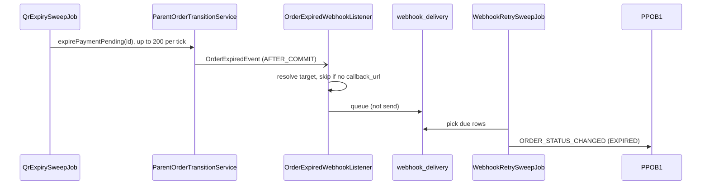

# PPOB2 — As-Built Architecture

What the code does that the PRD does not say. This is a companion to the PRD, not a copy of it: the
module list, dependency graph, state machine and sequence diagrams are already specified there and are
**not repeated here**. This document covers how that design was actually realised, and where the code
differs from it. Everything below is derived from the code (Gradle edges, Spring event publishers and
listeners, controllers, `application.yml`, Flyway migrations).

| For | Read |
|---|---|
| Module list and responsibilities | PRD Section 20.1 |
| Allowed dependencies | PRD Section 20.2 (matches the `build.gradle.kts` edges exactly; `ModuleArchitectureTest` guards it) |
| Order states and transitions | PRD Section 33 |
| Create / pay / fulfil / expire sequences | PRD Section 48.1–48.3, 48.6 |
| Why a trade-off was made | [`../backend/README.md`](../backend/README.md) |
| What is verified | [`TEST-STATUS.md`](TEST-STATUS.md) |

---

## 1. Two systems, one repository

`backend/` is PPOB2. `ppob1-sim/` is PPOB1, the reseller: a separate Spring Boot app with its own Gradle
build and its own Postgres database, sharing no code with `backend/` and reaching it only over signed
HTTP. That isolation is what makes it a conformance test of Section 23.

| External party | Real or stubbed today |
|---|---|
| Ayolinx | `AyolinxPaymentGateway` is real; `StubQrisPaymentGateway` is the default (`ppob2.payment.gateway=stub`) |
| Game providers | **Stub only** (`StubGameProviderAdapter`, `@Profile("!prod")`); the `prod` profile refuses to start. The main go-live blocker |
| Admin Web | REST API plus a small static console at `/backoffice/` (transactions, payments, callbacks, reconciliation, audit log). Not all of Section 41: no catalog / pricing / configuration editing, no dashboard |

---

## 2. Why `app` is more than a launcher

Section 20.2 gives `order`, `webhook`, `fulfillment` and `reconciliation` no edges to one another, but
several behaviours need several of them. That glue lives in `app`, as small orchestrators and listeners,
so the modules stay clean and the cross-module coupling is visible in one package.

| `app` class | Joins | Why it cannot live in a module |
|---|---|---|
| `FulfillmentDispatchListener` | `order` event → `fulfillment` + `reconciliation` + `webhook` | `fulfillment → order` exists; the reverse and the rest do not |
| `OutboundWebhookOrchestrator`, `WebhookDeliveryTargetResolver` | `order` + `partner` + `webhook` | The target is `parent_order.callback_url` joined to `partner.webhook_secret` |
| `OrderExpiredWebhookListener` | `order` event → `webhook` | Same join |
| `PaymentCallbackAnomalyOrchestrator`, `OrderFulfillmentReconciliationOrchestrator`, `MarginReconciliationOrchestrator` | `payment` / `order` events → `reconciliation` | `order` has no edge to `reconciliation` |
| `AdminRefundOrchestrator`, `AdminChildOrderRetryOrchestrator`, `SettlementIngestionOrchestrator` | Admin actions spanning modules | Same |
| `security/*`, `web/*` | The whole HTTP surface | One place for auth and error shape |

---

## 3. Event wiring

Modules that must not know each other communicate through Spring application events.

| Event | Published by | Listener | Phase |
|---|---|---|---|
| `PaymentConfirmedEvent` | `payment` (`PaymentCallbackService`) | `order` (`PaymentConfirmedEventListener` → `markPaid`) | `AFTER_COMMIT` |
| `ChildOrdersReadyEvent` | `order` (`ParentOrderTransitionService`) | `app` (`FulfillmentDispatchListener`) | `AFTER_COMMIT` |
| `OrderExpiredEvent` | `order` (`expirePaymentPending`) | `app` (`OrderExpiredWebhookListener`) | `AFTER_COMMIT` |
| `PaymentCallbackAnomalyEvent`, `LatePaymentOnUntransitionableOrderEvent`, `DecompositionExhaustedEvent` | `payment` / `order` | `app` reconciliation orchestrators | plain `@EventListener`, joins the publisher's transaction |

The phase is a decision, not a default. The first three are `AFTER_COMMIT` because the state change must
be durable before anyone acts on it. The anomaly events are deliberately the opposite: the
reconciliation record must commit **or roll back together** with the thing that caused it.

Events are published only on the branch of a transition that actually moved the order. A duplicate
trigger finds the order already moved, returns `false`, and publishes nothing.

---

## 4. Where the code goes beyond or differs from the PRD

### 4.1 State machine
The edges are `OrderStateMachine.ALLOWED` (anything else throws `IllegalStateException`). Beyond the
happy path of Section 33:

- `CREATED` may go directly to `CANCELLED` or `EXPIRED`.
- `PAID → REFUND_PENDING` exists for the no-eligible-pattern case (`DecompositionExhaustedEvent`).
- `PARTIAL_FAILED → SUCCESS` exists for a retried failed child.
- Moving `PARTIAL_FAILED` / `FAILED` into `REFUND_PENDING` is a deliberate Ops decision, not automatic;
  `AdminRefundOrchestrator` accepts only an order that is already `REFUND_PENDING`.

### 4.2 Expiry only sweeps `PAYMENT_PENDING`
`QrExpirySweepJob` expires `PAYMENT_PENDING` orders. `CREATED → EXPIRED` is legal but **nothing sweeps
it**, so an order left in `CREATED` (e.g. the gateway was unavailable) stays there.

### 4.3 Which states notify the partner
Only `SUCCESS`, `PARTIAL_FAILED`, `FAILED`, `EXPIRED` are pushed
(`WebhookDeliveryTargetResolver.NOTIFIABLE_STATES`). `CANCELLED` is not: the partner asked for it and
already has the answer in the cancel response. `REFUND_PENDING` / `REFUNDED` are admin-driven and not
pushed.

### 4.4 The expiry callback is queued, not sent
Section 48.3 shows `EXPIRED` followed by a webhook. The code queues the delivery
(`WebhookDeliveryTracker.scheduleFirstDelivery`, `attempt_count = 0`, due now) and lets
`WebhookRetrySweepJob` make every attempt, including the first.



A synchronous send would run up to 200 HTTP calls on the expiry thread; against an unreachable partner
that is 200 × the 5 s timeout, about 17 minutes in which no further order expires, and partner outages
are exactly when a backlog of unpaid orders is likely. `spring.task.scheduling.pool.size` (one thread per job) exists for
the same reason. The fulfillment path, by contrast, makes one synchronous attempt and schedules a retry
only on failure (`scheduleFirstRetry`, `attempt_count = 1`). Both origins reach the same 5 total attempts.

### 4.5 Recovering a lost create response
The create request accepts `metadata.reseller_txn_id`, stored on `parent_order` and echoed in the
outbound webhook body. A reseller that never received the create response can match the callback on its
own id and adopt PPOB2's order id. The id is indexed (`parent_order_reseller_txn_idx`, deliberately not
unique) and admin-searchable at `GET /admin/orders?reseller_txn_id=`.

This recovers on its own only when PPOB2 issued a QR and the partner has a `callback_url`. An order stuck
in `CREATED`, or a submit that never arrived, remains manual.

### 4.6 Failure and money-safety paths

| Situation | What happens |
|---|---|
| Duplicate PG callback | Dropped on `payment_event.dedup_key`; no second state change |
| `FAILED` after `SUCCESS` callback | `PaymentCallbackAnomalyEvent` → reconciliation record |
| Payment for an expired / cancelled order | `LatePaymentOnUntransitionableOrderEvent` → reconciliation record; refund is an admin action |
| Paid order, no eligible pattern | `DecompositionExhaustedEvent` → reconciliation record; order → `REFUND_PENDING` |
| A child order fails | `PARTIAL_FAILED` / `FAILED`; admin `POST /admin/child-orders/{id}/retry` or `POST /admin/parent-orders/{id}/refund` |
| Partner webhook endpoint down | `webhook_delivery` retried 5 times over ~23 h (`5,60,240,1080` min), then `EXHAUSTED` |
| Child references a missing SKU or price | Flagged `unresolvable`, never dispatched with an unknown cost |
| Idempotent replay | Same `Idempotency-Key` + matching request returns the original; `metadata` and `callback_url` are not compared (first write wins) |

---

## 5. Security boundaries

Four Spring Security filter chains, matched by path, plus the outbound signature. They share no
authentication scheme.

| Surface | Path | Authentication | Notes |
|---|---|---|---|
| Open API | `/api/v1/**` | `HmacAuthenticationFilter`: HMAC, ±5 min timestamp window, nonce replay check | Spring Security is `permitAll`; auth happens in the filter. `ChannelContextResolver` builds the `ChannelContext` |
| PG callback | `/internal/webhooks/**` | Ayolinx RSA signature, verified in `PaymentCallbackService` | The stub gateway has its own HMAC scheme, dev only |
| Admin API | `/admin/**`, `/internal/settlement/**` | `AdminSessionAuthenticationFilter`: opaque session token (HttpOnly cookie or `Authorization: Bearer`), Section 42.3 | Idle 30 min (slides) and absolute 8 h (never extended); TOTP MFA mandatory for SUPER_ADMIN / FINANCE / RECONCILIATION. HTTP Basic exists only behind `ppob2.admin.basic-auth-enabled` (default **off**) because it cannot carry a TOTP code |
| Backoffice UI | `/backoffice/**` | none: static files, no data | CSP with no inline script and `connect-src 'self'`, `X-Frame-Options: DENY`, `no-referrer`; everything it shows comes from the authenticated Admin API |
| Outbound webhook | PPOB2 → partner `callback_url` | Signed with `partner.webhook_secret`, with nonce | The sender uses its own bare `ObjectMapper`, so the body does not depend on Spring's Jackson settings |

### Admin sessions

```
login(password ok) --+-- MFA enrolled ----------> PENDING_MFA    --verify--> ACTIVE
                     +-- role needs MFA, none ---> PENDING_ENROLL --confirm--> ACTIVE
                     +-- otherwise --------------> ACTIVE
```

- A pending session authenticates as `ROLE_PENDING_MFA` only: it may call the MFA endpoints and nothing
  else. Promotion **rotates the token**, so the credential that existed before the second factor was proven
  is never the one that outlives it.
- Only the SHA-256 of a token is stored (`admin_session.token_hash`). TOTP secrets are AES-256-GCM encrypted
  with a key from configuration; replay is blocked by `admin_user.mfa_last_step`; five wrong codes revoke
  the session; five wrong passwords lock the account for 15 minutes.
- A cookie is ambient, so cookie-authenticated state-changing requests need `X-CSRF-Token` (derived from the
  token; `GET /admin/auth/me` returns it). `Authorization: Bearer` is not ambient and is exempt.
- Admin service methods re-load the session and user inside their own transaction: the filter's entities
  are detached by the time a controller runs, and with open-in-view off a change to a detached entity is
  silently dropped (this lost an MFA secret on the first live run).

### RBAC

Permissions are seeded only when something enforces them: `retry:execute`, `reconciliation:investigate`,
`reconciliation:resolve`, `reconciliation:view`, `settlement:ingest`, `refund:initiate`, `order:view`,
`payment:view`, `audit:view`, `session:revoke`, across roles `SUPER_ADMIN`, `OPERATIONS`,
`CUSTOMER_SERVICE`, `FINANCE`, `RECONCILIATION`, `TECH_SUPPORT`, `VIEWER` (V19, V21, V22, V24, V26, V27; each
migration argues its grants). Audited: failed logins, login success, MFA challenges and enrolment, logout,
session revocation, permission denials. Passwords, TOTP secrets and codes are asserted absent from `audit_log`.

`CorrelationIdFilter` tags every request. `GlobalExceptionHandler` is the single place that shapes error
bodies (`error_code`, `message`, `details`) and must not echo internals such as Java types or raw input.

---

## 6. Data conventions

One PostgreSQL schema, managed only by Flyway (`ddl-auto: validate`, so a missing column fails at boot).
27 migrations in `app/src/main/resources/db/migration`; PPOB1 has its own database.

- **Money is `Money` in Java and `NUMERIC(18,0)` in SQL.** Never `float` / `double` (Section 21.1).
- **JSONB needs `@JdbcTypeCode(SqlTypes.JSON)`.** `columnDefinition = "jsonb"` alone binds as `varchar`.
  Precedents: `WebhookEvent.payload`, `DecompositionPattern.components`, `AuditLog.*_state`.
- **A JSON `null` is not SQL `NULL`.** `objectMapper.writeValueAsString(null)` returns the text `null`,
  stored as a JSON null, which fails `IS NULL` and matches nothing in a `->>` lookup. Map "no value" to
  Java `null` yourself.
- **A functional index serves only its exact expression.** `metadata ->> 'reseller_txn_id'` is indexed;
  `->` is a different expression and does not use it.
- **Dedup is a database fact:** unique `payment_event.dedup_key`, unique `(parent_order_id, event_type)`
  on `webhook_delivery`, and the idempotency key on `parent_order`.
- **`webhook_delivery.last_attempt_at` is nullable (V25)** so `attempt_count = 0` with no attempt yet is
  representable.
- Ledger tables are append-only.

---

## 7. Background jobs

Three `@Scheduled(fixedDelay…)` jobs in the same JVM, on a scheduler pool of **3** threads
(`spring.task.scheduling.pool.size`, one per job) so a slow webhook batch cannot delay expiry.

| Job | Module | Interval | Does |
|---|---|---|---|
| `QrExpirySweepJob` | `order` | 60 s (`ppob2.order.expiry-sweep-interval-ms`) | Expires up to 200 `PAYMENT_PENDING` orders past `expires_at`, one transaction each |
| `WebhookRetrySweepJob` | `app` | 60 s (`ppob2.webhook.retry-sweep-interval-ms`) | Makes every attempt for due `webhook_delivery` rows; each result is recorded in its own `REQUIRES_NEW` transaction so no connection is held across an HTTP call |
| `AdminSecurityStartupCheck.purge` | `app` | 1 h | Deletes admin sessions that died more than a day ago |

None has leader election.

---

## 8. Operational limits

- **Single instance only.** The nonce store is an in-memory map (PRD Section 19.1 designates Redis) and
  the sweeps have no leader election; two instances would not coordinate.
- **Hikari `connection-timeout: 5s`**, so a database outage returns a prompt 503 instead of hanging 30 s.
- **`prod` does not boot** until a real `GameProvider` bean exists.
- **No pattern-generation engine** (Section 29): `decomposition_pattern` rows are hand-seeded.
- **No CI workflow**: the unit and e2e suites run only when someone runs them.
- **Reconciliation `resolve`** records who and when, not why (Section 41.9 resolution notes).
- **MFA reset** for a locked-out admin is a database operation; there is no UI or endpoint for it.

Product-level blockers: [`../README.md`](../README.md#go-live-blockers).
