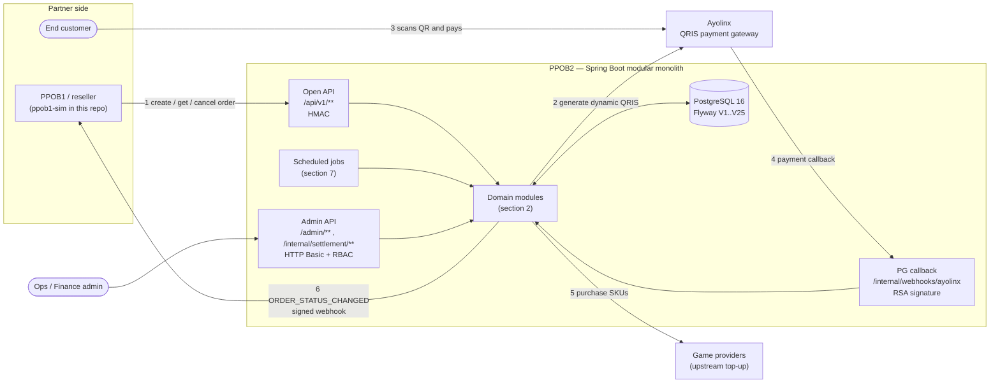
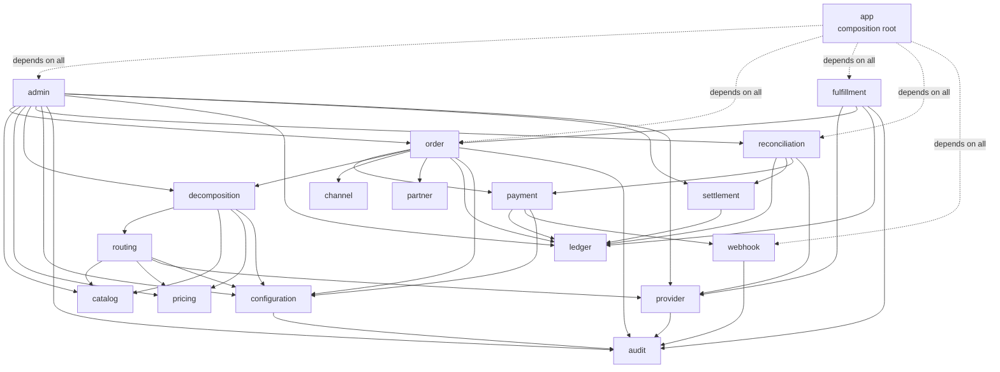
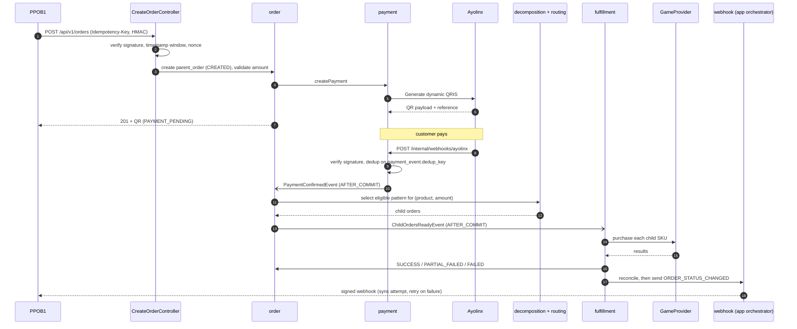
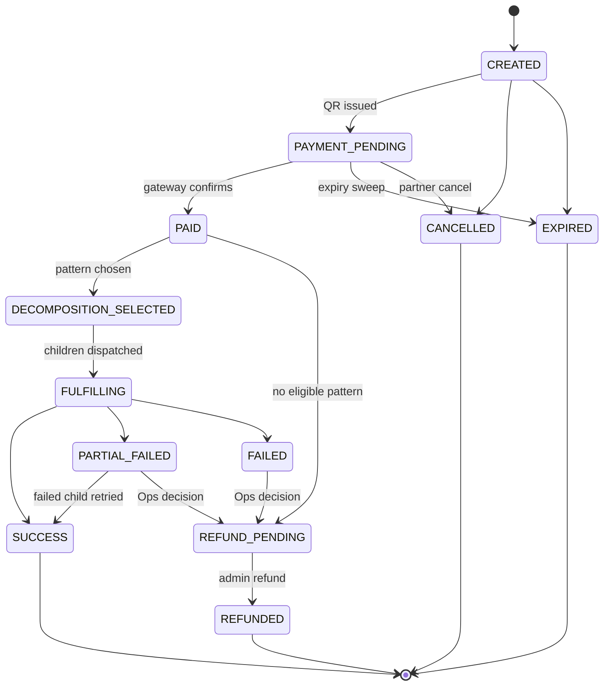
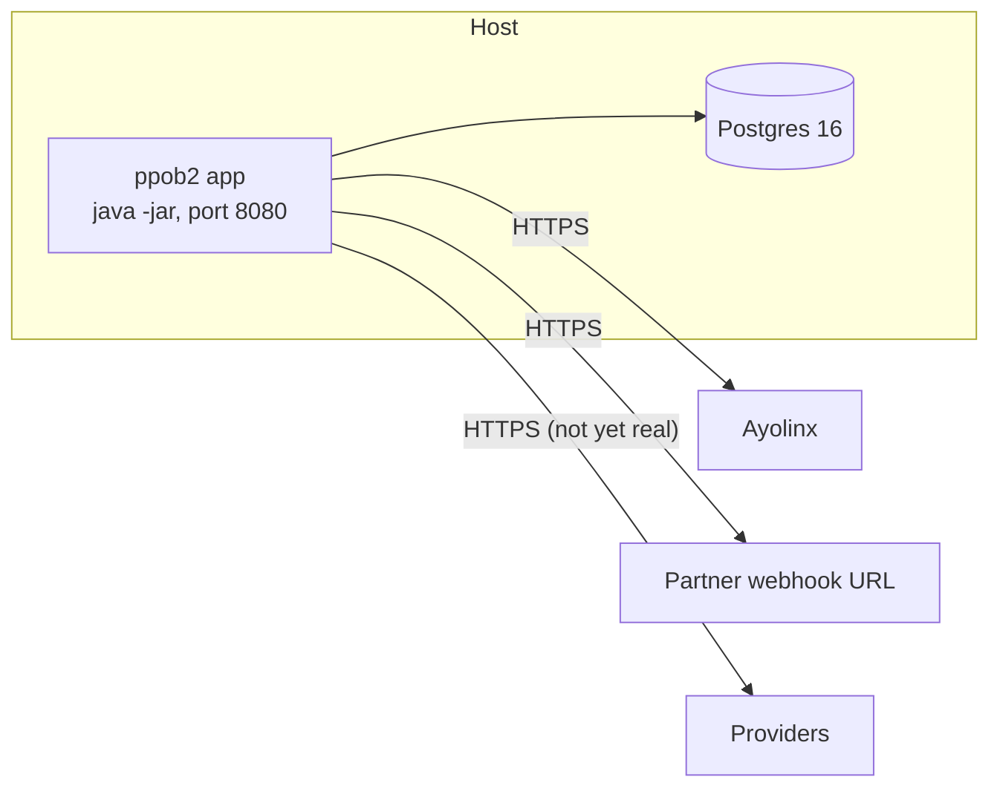

# PPOB2 — Architecture

How the system is put together. This document is derived from the code (Gradle project edges,
Spring event publishers/listeners, controllers, `application.yml`, Flyway migrations), not from the
PRD alone. Where the two differ, the code wins and the difference is called out.

- **What the system should do** → [`PRD-PPOB2.md`](PRD-PPOB2.md) (`Section N` = a PRD section)
- **Why a given trade-off was made** → [`../backend/README.md`](../backend/README.md)
- **What is actually verified** → [`TEST-STATUS.md`](TEST-STATUS.md)

Contents: [1. System context](#1-system-context) · [2. Modules](#2-modules) ·
[3. Request and event flows](#3-request-and-event-flows) · [4. Order state machine](#4-order-state-machine) ·
[5. Security boundaries](#5-security-boundaries) · [6. Data](#6-data) ·
[7. Background jobs](#7-background-jobs) · [8. Deployment and limits](#8-deployment-and-limits)

---

## 1. System context

PPOB2 sells game top-ups to a reseller (PPOB1). The partner creates an order, the end customer pays a
dynamic QRIS code issued through Ayolinx, and the paid amount is **decomposed** into one or more
provider SKUs that are purchased upstream. PPOB2 then tells the partner the result by signed webhook.



| External party | Direction | Contract | Real or stubbed |
|---|---|---|---|
| **PPOB1** | in: orders; out: webhooks | PRD Section 23, HMAC-signed | `ppob1-sim/` is a separate app that exercises it; a real reseller is the same contract |
| **Ayolinx** | out: Generate QRIS; in: payment callback | PRD Section 25 | `AyolinxPaymentGateway` is real; `StubQrisPaymentGateway` is the default (`ppob2.payment.gateway=stub`) |
| **Game providers** | out: purchase / inquiry | `GameProvider` interface | **Stub only** (`StubGameProviderAdapter`, `@Profile("!prod")`). The `prod` profile refuses to start. This is the main go-live blocker |
| **Admin users** | in | REST, HTTP Basic against `admin_user` | Real; no UI, REST slice only |

The repository holds **two independent systems**. `ppob1-sim` has its own Gradle build, its own
Postgres database, and reaches PPOB2 only over signed HTTP. It shares no code with `backend/`, which is
what makes it a conformance test of Section 23 instead of a second door into PPOB2's internals.

---

## 2. Modules

`backend/` is one deployable (`app`) built from 19 Gradle subprojects. Dependencies between modules are
Gradle project edges, so an illegal import does not compile; `ModuleArchitectureTest` (ArchUnit) guards
the rest. The edges below are the actual `build.gradle.kts` edges and they match PRD Section 20.2.
Every module also depends on `shared-kernel` (`Money`, error types, shared value objects), omitted from
the drawing.



### Layers

| Layer | Modules | Rule |
|---|---|---|
| **Foundation** | `shared-kernel`, `audit`, `configuration`, `channel`, `partner`, `catalog`, `pricing`, `ledger` | Never depend upward on `order`, `admin`, `decomposition`... |
| **Capabilities** | `provider`, `routing`, `decomposition`, `payment`, `settlement`, `webhook` | One job each; `payment → webhook` (inbound callback dedup) |
| **Workflows** | `order`, `fulfillment`, `reconciliation` | Own state machines and cross-source matching |
| **Operations** | `admin` | The only module allowed to depend broadly |
| **Composition** | `app` | Wires everything; owns HTTP controllers, security, and the glue that no module may own |

### What each module owns

| Module | Owns |
|---|---|
| `channel`, `partner` | Channel / partner / API-client registry; `partner.webhook_secret`, `callback_url` limits |
| `catalog` | Product, provider, provider SKU master data |
| `pricing` | Provider price versions, supported-amount tiers, margin computation |
| `configuration` | Central config store (amounts, weights, fees, flags), audited |
| `routing` | Runtime scoring and eligible-pattern selection |
| `decomposition` | Pattern lookup / invalidation (patterns are hand-seeded; the generator is not built) |
| `provider` | `GameProvider` abstraction, circuit breaker, health |
| `payment` | `PaymentGateway` abstraction (Ayolinx + stub), QRIS lifecycle, callback processing, refunds |
| `order` | Parent / child order lifecycle, state machine, `QrExpirySweepJob`, domain events |
| `fulfillment` | Child-order execution, concurrency control, compensation |
| `ledger` | Append-only order / payment / provider / settlement entries |
| `settlement` | Settlement record ingestion and allocation per partner |
| `reconciliation` | Cross-source matching, discrepancy records, `investigate` / `resolve` |
| `webhook` | Inbound event log, outbound signed sender, `webhook_delivery` retry tracking |
| `audit` | Immutable audit log |
| `admin` | Admin users, RBAC, admin use cases |

### Why `app` is not just a launcher

Section 20.2 gives `order`, `webhook` and `fulfillment` no edge to one another, yet several behaviours
need all of them. Those live in `app`, each as a small orchestrator or listener, so the modules stay
clean and the coupling is visible in one place:

| `app` class | Joins | Why it cannot live in a module |
|---|---|---|
| `FulfillmentDispatchListener` | `order` event → `fulfillment` + `reconciliation` + `webhook` | `fulfillment → order` exists, the reverse and the rest do not |
| `OutboundWebhookOrchestrator`, `WebhookDeliveryTargetResolver` | `order` + `partner` + `webhook` | The webhook target is `parent_order.callback_url` joined to `partner.webhook_secret` |
| `OrderExpiredWebhookListener` | `order` event → `webhook` | Same join |
| `PaymentCallbackAnomalyOrchestrator`, `OrderFulfillmentReconciliationOrchestrator`, `MarginReconciliationOrchestrator` | `payment` / `order` events → `reconciliation` | `order` has no edge to `reconciliation` |
| `AdminRefundOrchestrator`, `AdminChildOrderRetryOrchestrator`, `SettlementIngestionOrchestrator` | Admin actions across modules | Same |
| `security/*`, `web/*` | HTTP surface | One place for auth and error shape |

---

## 3. Request and event flows

Modules talk through **Spring application events** rather than direct calls where the two sides must not
know each other. Four events drive the whole order lifecycle:

| Event | Published by | Listener | Phase |
|---|---|---|---|
| `PaymentConfirmedEvent` | `payment` (`PaymentCallbackService`) | `order` (`PaymentConfirmedEventListener` → `markPaid`) | `AFTER_COMMIT` |
| `ChildOrdersReadyEvent` | `order` (`ParentOrderTransitionService`) | `app` (`FulfillmentDispatchListener`) | `AFTER_COMMIT` |
| `OrderExpiredEvent` | `order` (`expirePaymentPending`) | `app` (`OrderExpiredWebhookListener`) | `AFTER_COMMIT` |
| `PaymentCallbackAnomalyEvent`, `LatePaymentOnUntransitionableOrderEvent`, `DecompositionExhaustedEvent` | `payment` / `order` | `app` reconciliation orchestrators | plain `@EventListener`, joins the publisher's transaction |

`AFTER_COMMIT` is deliberate for the first three: the state change must be durable before anyone acts on
it. The anomaly events are the opposite on purpose: the discrepancy record must commit **or roll back
together** with the thing that caused it.

### 3.1 Create order → pay → fulfil → notify



Idempotency: `Idempotency-Key` is stored on `parent_order`; a replay with a matching request returns the
original order, a mismatch is rejected. `metadata`, `callback_url` are deliberately **not** compared on
replay (first write wins).

### 3.2 Unpaid order expires

```mermaid
sequenceDiagram
    participant JOB as QrExpirySweepJob (order)
    participant ORD as ParentOrderTransitionService
    participant LSN as OrderExpiredWebhookListener (app)
    participant DLV as webhook_delivery
    participant SWP as WebhookRetrySweepJob (app)
    participant P1 as PPOB1

    JOB->>ORD: expirePaymentPending(id) for up to 200 due orders
    ORD->>ORD: PAYMENT_PENDING -> EXPIRED
    ORD-)LSN: OrderExpiredEvent (AFTER_COMMIT)
    LSN->>LSN: resolve target; skip if no callback_url
    LSN->>DLV: scheduleFirstDelivery (attempt_count = 0, due now)
    Note over LSN,DLV: queued, NOT sent. A synchronous send here would run<br/>up to 200 HTTP calls on the expiry thread.
    SWP->>DLV: pick due rows
    SWP->>P1: ORDER_STATUS_CHANGED (EXPIRED)
```

The delivery is queued instead of sent because a partner outage is exactly when a backlog of unpaid
orders is likely, and 200 sequential 5s timeouts would stall expiry for ~17 minutes.
`spring.task.scheduling.pool.size: 2` exists for the same reason.

### 3.3 Lost create-response recovery

The webhook body carries `reseller_txn_id` (echoed from `metadata.reseller_txn_id` at create time). If
PPOB1 never received the create response, it holds a transaction with no PPOB2 order id; the callback
lets it adopt the id by matching its own. The same id is indexed (`parent_order_reseller_txn_idx`) and
searchable by admins at `GET /admin/orders?reseller_txn_id=`.

### 3.4 Failure and money-safety paths

| Situation | What happens |
|---|---|
| Duplicate PG callback | Dropped on `payment_event.dedup_key`, no second state change |
| `FAILED` after `SUCCESS` callback | Raises `PaymentCallbackAnomalyEvent` → reconciliation record |
| Payment arrives for an expired / cancelled order | `LatePaymentOnUntransitionableOrderEvent` → reconciliation record; refund is an admin action |
| Paid order, no eligible decomposition pattern | `DecompositionExhaustedEvent` → reconciliation record (collected money must never be silent) |
| A child order fails | Order ends `PARTIAL_FAILED` / `FAILED`; admin `POST /admin/child-orders/{id}/retry` or `POST /admin/parent-orders/{id}/refund` |
| Partner webhook endpoint is down | `webhook_delivery` retried 5 times over ~23h (`5,60,240,1080` min), then `EXHAUSTED` |
| Child order references a missing SKU or price | Flagged `unresolvable`, not dispatched with an unknown cost |

---

## 4. Order state machine

States are the `OrderState` enum (PRD Section 33.1).



The edges are `OrderStateMachine.ALLOWED`, the single source of truth; anything not listed throws
`IllegalStateException`. Two things the diagram does not say on its own: `QrExpirySweepJob` only
expires `PAYMENT_PENDING` orders, so an order left in `CREATED` (e.g. the payment gateway was
unavailable) is *legal* to expire but nothing sweeps it; and the move into `REFUND_PENDING` from
`PARTIAL_FAILED`/`FAILED` is a deliberate Ops decision, not automatic, while `AdminRefundOrchestrator`
only accepts an order that is already `REFUND_PENDING`.

Only terminal states that the partner is told about are pushed by webhook: `SUCCESS`, `PARTIAL_FAILED`,
`FAILED`, `EXPIRED` (`WebhookDeliveryTargetResolver.NOTIFIABLE_STATES`). `CANCELLED` is not pushed: the
partner asked for it and already has the answer in the cancel response.

Transitions are guarded in `ParentOrderTransitionService` and return a boolean for "did I move it", so a
duplicate trigger is a no-op rather than an error; events are published only on the branch that moved.

---

## 5. Security boundaries

Four Spring Security filter chains, each matched by path. None shares an authentication scheme with the
others.

| Surface | Path | Authentication | Notes |
|---|---|---|---|
| Open API (partner → PPOB2) | `/api/v1/**` | `HmacAuthenticationFilter`: HMAC signature, ±5 min timestamp window (`signature-window-ms`), nonce replay check | Spring Security is `permitAll`; auth happens in the filter. `ChannelContextResolver` builds the caller's `ChannelContext` |
| PG callback | `/internal/webhooks/**` | Ayolinx RSA signature, verified in `PaymentCallbackService` | Stub gateway uses its own HMAC scheme, dev only |
| Admin | `/admin/**`, `/internal/settlement/**` | HTTP Basic against `admin_user` | Fine-grained permission via `@PreAuthorize("hasAuthority('…')")` |
| Outbound webhook | PPOB2 → partner `callback_url` | Signed with `partner.webhook_secret`, with nonce | Sender uses its own bare `ObjectMapper` so the body is stable |

Admin RBAC (V19, V21, V22, V24): the permission codes `retry:execute`, `reconciliation:investigate`,
`reconciliation:resolve`, `reconciliation:view`, `settlement:ingest`, `refund:initiate` and `order:view`
(only permissions something actually enforces are seeded) are granted to roles
(`SUPER_ADMIN`, `OPERATIONS`, `CUSTOMER_SERVICE`, `FINANCE`, `RECONCILIATION`, `TECH_SUPPORT`,
`VIEWER`). Authentication failures are audited by `AdminSecurityAuditListener`.

Cross-cutting: `CorrelationIdFilter` tags every request; `GlobalExceptionHandler` is the single place
that shapes error bodies (`error_code`, `message`, `details`) and must not echo internals.

Not hardened yet: the nonce store is an in-memory map (single instance), and the per-chain `permitAll`
configuration relies entirely on the filters in front of it.

---

## 6. Data

One PostgreSQL schema for PPOB2, managed only by Flyway (`ddl-auto: validate`, so a missing column
fails at boot, not at runtime). 25 migrations in `app/src/main/resources/db/migration`.

| Area | Migrations | Main tables |
|---|---|---|
| Base | V1–V4 | `updated_at` trigger, channel / partner / api_client, product + supported amount, audit_log |
| Order and payment | V5–V6, V14–V15, V21, V23 | parent_order, child_order, payment, payment_event, refund execution, `metadata` |
| Catalog and routing | V7–V9, V13 | provider, provider_sku, provider_price, decomposition_pattern, fulfillment |
| Money books | V10–V12, V20 | ledger, settlement (+ per-partner allocation), reconciliation |
| Webhooks | V16, V18, V25 | outbound webhook, `webhook_delivery` (retry state) |
| Admin | V17, V19, V22, V24 | admin_user, RBAC roles and permissions |

Conventions that matter when you touch the schema:

- **Money is `Money` in Java and `NUMERIC(18,0)` in SQL.** Never `float`/`double` (PRD Section 21.1).
- **JSONB columns need `@JdbcTypeCode(SqlTypes.JSON)`.** `columnDefinition = "jsonb"` alone binds as
  `varchar`. Precedents: `WebhookEvent.payload`, `DecompositionPattern.components`, `AuditLog.*_state`.
- **A JSON `null` is not SQL `NULL`.** `objectMapper.writeValueAsString(null)` yields the text `null`,
  stored as a JSON null; map "no value" to Java `null` yourself.
- **A functional index serves only its exact expression.** `metadata ->> 'reseller_txn_id'` is indexed;
  `->` is not the same index.
- **Dedup is a database fact**, not an in-memory one: unique keys on `payment_event.dedup_key`,
  `(parent_order_id, event_type)` on `webhook_delivery`, and the idempotency key on `parent_order`.
- Ledger tables are append-only.

PPOB1's database is separate: `ppob1_transaction`, `ppob1_inbound_webhook`, recon entries, collection
snapshots (`ppob1-sim/`).

---

## 7. Background jobs

Both are `@Scheduled(fixedDelay…)` in the same JVM, on a scheduler pool of **2** threads
(`spring.task.scheduling.pool.size`) so a slow webhook batch cannot delay expiry.

| Job | Module | Interval | Does |
|---|---|---|---|
| `QrExpirySweepJob` | `order` | 60 s (`ppob2.order.expiry-sweep-interval-ms`) | Expires up to 200 unpaid `PAYMENT_PENDING` orders past `expires_at`, one transaction each |
| `WebhookRetrySweepJob` | `app` | 60 s (`ppob2.webhook.retry-sweep-interval-ms`) | Makes every attempt for `webhook_delivery` rows that are due; each result is recorded in its own short `REQUIRES_NEW` transaction so no DB connection is held across an HTTP call |

Neither has leader election.

---

## 8. Deployment and limits



- **Runtime:** Java 21, Spring Boot 3.3, Gradle Kotlin DSL, `docker compose` for local Postgres.
  Configuration is environment-driven (`PPOB2_DB_URL`, `PPOB2_PAYMENT_GATEWAY`, `PPOB2_AYOLINX_*`, ...).
- **Observability:** actuator endpoints, correlation id on every request, Hikari
  `connection-timeout: 5s` so a database outage returns a prompt 503 instead of hanging for 30s.
- **Single instance only.** The nonce store is in-memory and the sweeps have no leader election; two
  instances would not coordinate. Redis-backed nonces and a sweep lock are the prerequisite for scaling out.
- **Profiles:** `prod` boots only if a real `GameProvider` bean exists. Today none does, by design.

### Known gaps (architecture-relevant)

1. No real provider adapter (go-live blocker).
2. No pattern-generation engine (Section 29); `decomposition_pattern` is hand-seeded.
3. Single instance (nonce store, sweeps).
4. No CI workflow: unit and e2e suites only run when someone runs them.
5. Reconciliation `resolve` records who and when, not why (Section 41.9 resolution notes).

See [`../README.md`](../README.md#go-live-blockers) for the product-level list.
